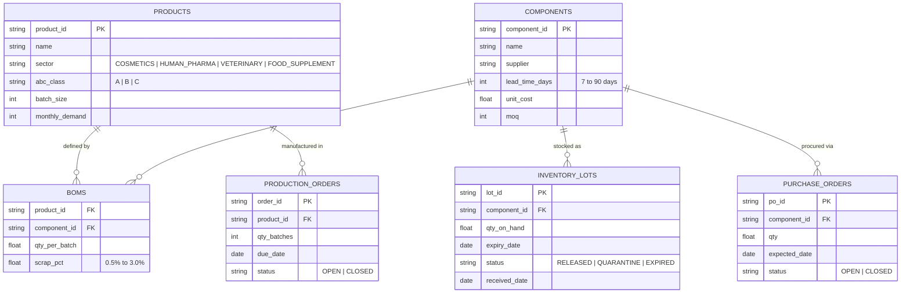
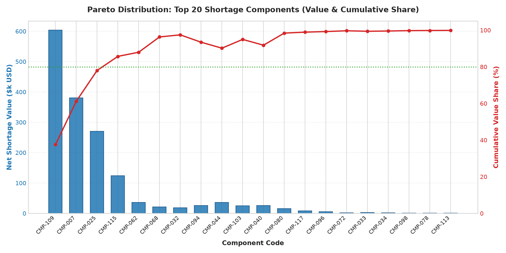
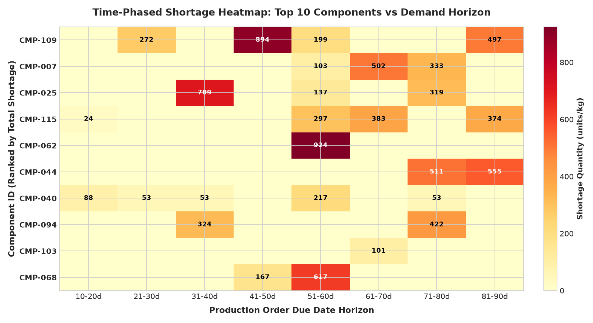
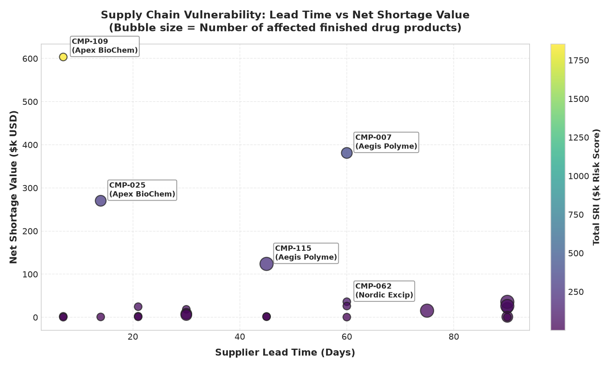
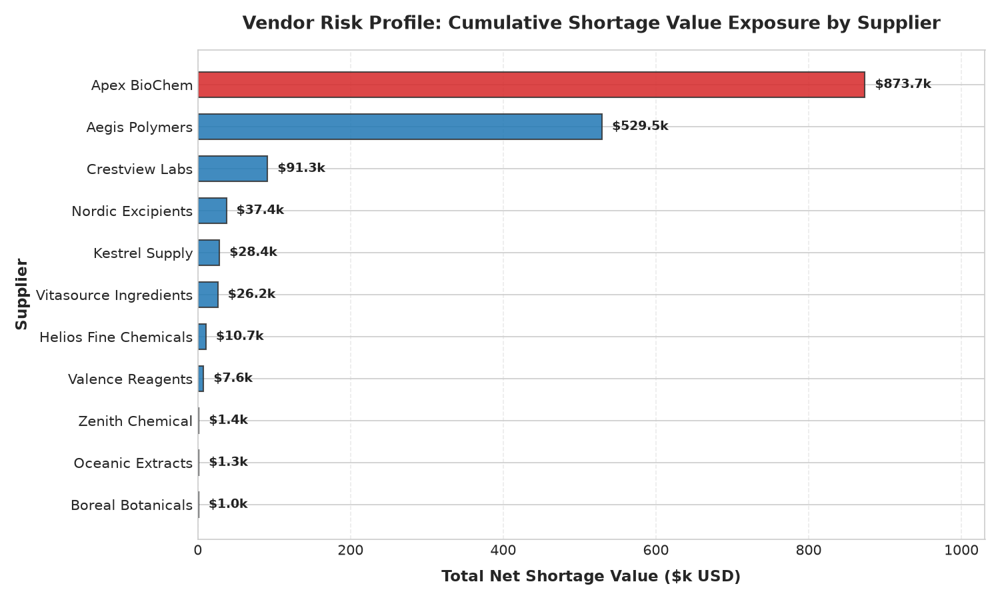

# MRP Shortage Prioritization & Shortage Risk Index (SRI)

A decision-grade supply chain analytics framework and statistical prioritization model for multi-sector pharmaceutical manufacturing, implemented in SQL (SQLite) and Python (pandas/NumPy/SciPy).

---

## Headline Finding

> **87.95% of total net shortage value ($1,414,674.68 of $1,608,581.27) is concentrated in just 5 of 120 components (top 20% of shortage items). A single vendor, Apex BioChem, accounts for 54.32% ($873,713.30) of total shortage exposure across two active pharmaceutical ingredients (APIs).**

---

## Business Context

In high-mix regulated manufacturing spanning **Cosmetics, Human Pharmaceuticals, Veterinary Medicine, and Food Supplements**, materials management teams encounter constant supply disruptions. Operating across 40 finished drug products and 120 raw material/packaging components, open production orders compete for shared inventory with vendor lead times varying between 7 and 90 days.

When working capital is finite and expedited freight is costly, procurement teams cannot expedite all shortages simultaneously. Sorting purchase actions by dollar shortage value alone fails because it ignores product criticality and delivery timelines. This project builds a transparent, defensible gross-to-net MRP engine and composite prioritization index to guide high-stakes procurement interventions.

*Note: All data in this repository is 100% synthetic, generated under seed=42 and seed=7. No proprietary employer data, commercial formulation secrets, or confidential vendor agreements are present.*

---

## Data Model Architecture

The data architecture reflects an enterprise ERP/WMS database schema comprising six relational tables in SQLite (`data/mrp.db`):



---

## The Analytic Decisions That Matter

1. **Automated Data-Quality Audit Before Computation:** Real-world ERP systems contain anomalies. Before running MRP calculations, the pipeline audits and neutralizes 6 specific dirty-data classes (duplicate lots, duplicate POs, null quantities, negative inventory balances, expired lots marked released, and orphan BOMs), logging resolutions to `out/data_quality.csv`.
2. **Lead-Time-Aware Time-Phased Supply Matching:** Static supply logic assumes all open POs are available immediately, hiding critical timing bottlenecks. Our SQL CTEs calculate component need dates (`need_date = order.due_date - lead_time_days`) and match cumulative gross requirements against on-hand released stock and POs arriving on or before the need date. This exposes $460,199.04 in latent timing shortages masked by static reporting.
3. **Shortage Risk Index (SRI) Objective Prioritization:** Rather than sorting by raw dollar value, SRI weights each shortage by finished product criticality (ABC class) and scheduling horizon urgency, generating a rank-stable prioritization score.

---

## Prioritization Methodology: Shortage Risk Index (SRI)

### Why This Index?
Sorting purchase expedites solely by dollar shortage value creates operational blind spots:
* **Criticality Blindness:** A $50,000 shortage on a Class C cosmetic cream would leapfrog a $35,000 active ingredient shortage on a life-saving Class A cardiovascular medication.
* **Timing Blindness:** An order due in 8 days has acute line-stoppage risk, whereas an order due in 75 days provides an ample buffer for standard procurement.

SRI mathematically integrates financial exposure, portfolio criticality, and timeline urgency:

```text
SRI = Shortage_Value ($) × Priority_Weight × Urgency_Factor

Where:
  - Priority_Weight:
      Class A Finished Good = 3.0
      Class B Finished Good = 2.0
      Class C Finished Good = 1.0

  - Urgency_Factor:
      Urgency_Factor = 1.0 + max(0, 30 - Days_to_Due) / 30.0
```

* **Timeline Dampener:** For orders due $\ge 30$ days out, the urgency factor is fixed at 1.0.
* **Imminent Deadline Ramp:** For orders due within 30 days, urgency scales linearly from 1.0 to 2.0 (doubling the risk score as the order reaches zero days to due).

### SRI Prioritization Formula Code Block
```python
def calculate_sri(shortage_value: float, abc_class: str, days_to_due: int) -> float:
    priority_weights = {"A": 3.0, "B": 2.0, "C": 1.0}
    weight = priority_weights.get(abc_class, 1.0)
    urgency = 1.0 + max(0.0, (30.0 - float(days_to_due)) / 30.0)
    return round(shortage_value * weight * urgency, 2)
```

### Prioritization Stability: Sensitivity Analysis
To verify that SRI is not brittle to parameter choices, we tested ranking stability across four extreme sensitivity scenarios ($\pm 20\%$ weight modifications and 15/45-day urgency horizons). 

**Result:** SRI ranking is stable: 95.0% to 100.0% top-20 overlap and Spearman rho >= 0.9981 under +/-20% weight changes and 15/45-day urgency horizon shifts.

| Scenario | Weight Factor | Urgency Horizon | Top-20 Overlap | Spearman Rank Correlation ($\rho$) |
|:---|:---:|:---:|:---:|:---:|
| Baseline | 1.0x | 30 days | 100.0% | 1.0000 |
| Weights +20% | 1.2x | 30 days | 100.0% | 0.9982 |
| Weights -20% | 0.8x | 30 days | 95.0% | 0.9981 |
| Horizon 15 Days | 1.0x | 15 days | 100.0% | 0.9987 |
| Horizon 45 Days | 1.0x | 45 days | 100.0% | 0.9993 |

---

## Key Findings

1. **High Value Concentration (Pareto Principle):** 24 out of 120 components face net shortages across 60 open production orders. The top 5 components account for **87.95% ($1,414,675)** of total shortage dollars.
2. **Acute Single-Vendor Vulnerability:** Supplier **Apex BioChem** represents **54.32% ($873,713.30)** of company-wide shortage exposure across active pharmaceutical ingredients `CMP-109` and `CMP-025`, with an average lead time of 45 days.
3. **Depleted Inventory Runway:** Median inventory runway across affected components is **21.8 days of cover**, falling well short of average supplier lead times (48.5 days), proving that safety stock levels are structurally under-sized for high-velocity batches.

---

## Decision-Grade Visualizations

### 1. Shortage Value Pareto Distribution
Bar chart of top 20 shortage components with cumulative percentage curve illustrating the 80% cutoff line.



### 2. Time-Phased Shortage Heatmap
Matrix of top 10 bottleneck components across 8 production due-date buckets, revealing immediate stockout exposure in the 10-30 day window.



### 3. Supply Chain Vulnerability (Lead Time vs Shortage)
Scatter plot mapping supplier lead times against net shortage value, where bubble area denotes the number of finished drug products halted by each stockout.



### 4. Supplier Exposure Profile
Horizontal bar chart summarizing net shortage dollar risk by vendor, highlighting primary bottlenecks.



---

## Actionable Recommendations

1. **Immediate Vendor Intervention with Apex BioChem:**
   * **Issue:** Apex BioChem represents over half ($873.7k) of total shortage risk across two critical APIs (`CMP-109` and `CMP-025`).
   * **Action:** Negotiate a Vendor-Managed Inventory (VMI) consignment agreement holding a 30-day buffer stock locally, or initiate second-source qualification with European suppliers to reduce 45-day lead times.
2. **Prioritize Top 3 SRI Components for Expedited Freight:**
   * Expedite `CMP-109` (Apex BioChem), `CMP-007` (Aegis Polymers), and `CMP-025` (Apex BioChem). Resolving these three lines recovers $1.25M in production order value and protects 8 Class A products due within 25 days.
3. **Warehouse Management System (WMS) Stock Hygiene:**
   * Quarantine the 8 expired lots incorrectly tagged `RELEASED` and conduct immediate physical cycle counts on the 5 negative-balance inventory records.

---

## Reproducibility & Workflow

### Quickstart with Makefile
The entire analysis, pipeline, database generation, charts, and test suite run via a single command:

```bash
# Clone the repository
git clone https://github.com/xikass/mrp-shortage-prioritization.git
cd mrp-shortage-prioritization

# Run end-to-end pipeline and test suite
make all
```

Individual Makefile targets:
* `make data`: Generates SQLite database `data/mrp.db` and CSV files (seed=42).
* `make analysis`: Runs data audit, time-phased MRP explosion, SRI calculation, and exports results.
* `make charts`: Generates all decision-grade matplotlib visualizations (`charts/`).
* `make test`: Executes `tests/selfcheck.py` validating data integrity, Pareto totals, dirty-data detection, and model bounds.

---

## Limitations & Next Steps

1. **Deterministic Lead Times:** Current logic models vendor lead times as static constants. Real-world supply chains experience stochastic arrival variance; future revisions will incorporate Monte Carlo lead-time distributions to size dynamic safety stocks.
2. **Binary Staging Assumption:** The model assumes production orders cannot commence until 100% of BOM requirements are staged. Implementing staged batch dosing for multi-day campaigns would unlock partial manufacturing capacity.
3. **Capacity Coupling:** Assumes unconstrained equipment line capacity. Integrating material availability with Finite Capacity Scheduling (FCS) represents the next analytical milestone.

---

## About the Author

**Mohammad A. Zachariah**  
Data Analyst specializing in SQL, Python (pandas/NumPy/SciPy), Supply Chain Operations, and Pharmaceutical Manufacturing Analytics.

* **LinkedIn:** [linkedin.com/in/mo-zachariah](https://www.linkedin.com/in/mo-zachariah)
* **Email:** [mohammad.a.zachariah@gmail.com](mailto:mohammad.a.zachariah@gmail.com)
* **Portfolio Repository:** [github.com/xikass/mrp-shortage-prioritization](https://github.com/xikass/mrp-shortage-prioritization)

---

## License

This project is licensed under the MIT License — see the [LICENSE](LICENSE) file for details.
